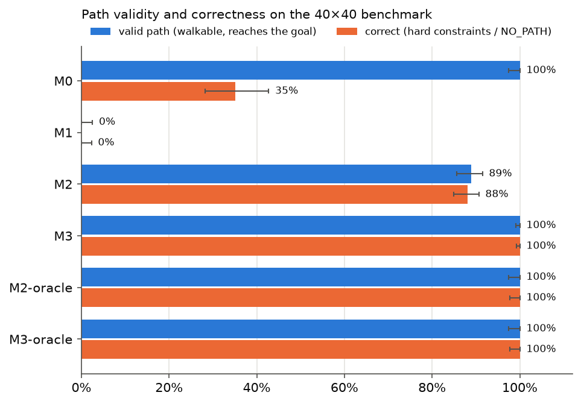
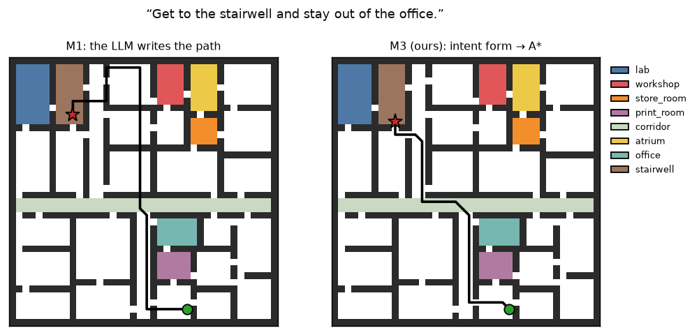
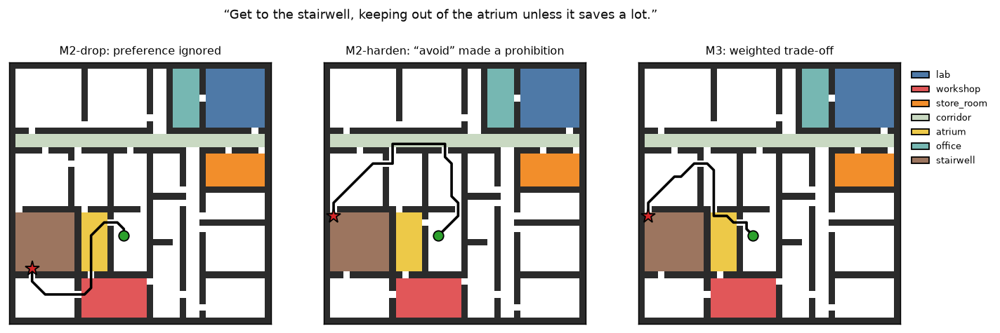
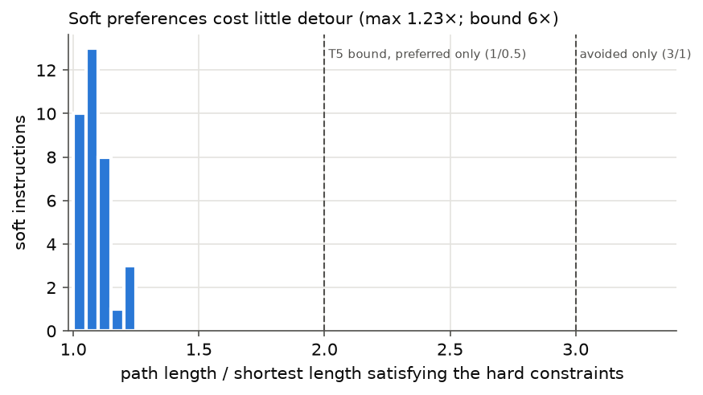

# Natural Language Path Finding with a Soundness Guarantee

**Shashi Bhidodiya (230956) · Krishna Kumayu (230576)** — IIT Kanpur, undergraduate project

## 1. Problem

A grid planner accepts one goal cell. People give instructions such as *"go to the
lab, don't go through the workshop, stop at the store room first, and stay in the
corridor if you can"* — a destination, a prohibition, an ordered stop and a soft
preference. We want paths that are **guaranteed walkable**, satisfy the **hard**
constraints, honour **soft** preferences in proportion, and are obtained **without
building a formal logic specification**.

The two existing answers both fall short. Translating the sentence into LTL gives
guarantees, but the formula is hard to get right, unreadable to the user, and cannot
express "if you can". Asking a language model for the path directly handles any
phrasing but gives no guarantee at all.

## 2. Method (M3)

The language model decides **what** the user wants; A\* decides **how**.

1. **Parser.** The LLM receives only the instruction and the list of region names and
   returns a JSON *intent form*: goal, forbidden regions, ordered waypoints, preferred
   regions, avoided regions. It never sees the grid and never writes a coordinate.
   The form is validated (names on the map, no contradictions); on failure the error
   is fed back, at most 3 calls.
2. **Compiler.** Forbidden regions become walls; preferred cells cost 0.5, avoided
   cells 3, others 1.
3. **Planner.** A\* over states *(cell, number of waypoints visited in order)*, 8-connected
   with no corner cutting, heuristic `w_min · octile distance` to the goal. Ordering is
   strict: a later waypoint (or the goal) is never entered before an earlier one.
4. **Verifier.** An independent checker, written without the planner's code, re-checks
   every returned path; a failure raises an error and is never returned.

## 3. Guarantees

Proved in [`soundness.md`](soundness.md), in plain language:

| | Statement | Holds |
|---|---|---|
| T1 | the path is walkable, or the answer is `NO_PATH` | always — **even when the parser is wrong** |
| T2 | the path satisfies every hard constraint of the intent form | always |
| T3 | `NO_PATH` only if the intent form is impossible on the map | always |
| T4 | the path is the cheapest one satisfying the form | always |
| T5 | soft preferences lengthen the path by at most w_max/w_min ≤ 6× | always |
| T6 | on hard constraints the intent form means exactly an LTLf formula | on our (corner-separated) maps |

The guarantee is conditional on a correct parse for T2–T5, and **parse accuracy is
measured**, not assumed. The LTL route has the same structure (its guarantee needs a
correct formula); the end-to-end LLM route has none.

The theorems are carried to the code by property-based tests (1000 random grids per
property against an independent networkx solver), a T6 cross-check (the LTL planner fed
the gold formula and our planner fed the gold intent return equal optimal costs on all
185 benchmark instructions), and the runtime verifier, which rejected **0** of the 850
paths our pipeline returned in the evaluation (M3, M3-oracle, M3-chain, both map sizes).

## 4. Evaluation setup

- **Maps:** 20 generated 40×40 floor plans (easy / medium / hard) and 10 15×15 plans;
  rooms, corridors and 1-cell doorways; every cell's region known exactly.
- **Benchmark:** 165 instructions × 3 wordings = 495 inputs, in six categories (plain 20,
  prohibition 35, stop 30, ordering 30, soft 35, infeasible 15); 30 instructions are
  hand-written in deliberately messy phrasing. Each has a gold intent form, a gold LTLf
  formula (from T6) and machine-checkable checks. Feasibility labels and optimal costs
  come from an independent networkx solver. Constraints are chosen so that they matter:
  every prohibition changes the optimal route (35/35), and every soft instruction
  is one where honouring the preference changes the route. Plus 20 instructions on the
  15×15 maps.
- **Methods:** M0 plain A\* to the goal (floor) · M1 end-to-end LLM (sees the ASCII map,
  writes the path) · M2 LLM → LTLf → Spot automaton → product planner · M3 ours.
  Ablations: gold input to each planner (M2-/M3-oracle), M2-harden (soft "avoid"
  made a prohibition), M3-chain (waypoints chained instead of the product search).
- **LLM:** Gemini `gemini-3.5-flash-lite`, temperature 0, same legend text and same
  retry budget for M1–M3. M2 and M3 see all three wordings; M1 the first (its metric is
  walkability). Every answer is cached in `cache/llm/`, so all numbers reproduce
  without an API key.
- **Statistics:** Wilson 95% intervals on rates, exact paired McNemar tests, bootstrap
  intervals on cost ratios. All tables: [`results/tables/big_all.md`](../results/tables/big_all.md).

## 5. Results (40×40 maps)



**Correct** = all hard checks pass on a feasible instruction, or `NO_PATH` on an
infeasible one.

| Method | plain | prohibition | stop | ordering | soft | infeasible | **all** |
|---|---|---|---|---|---|---|---|
| M0 plain A\* | 100% | 0% | 10% | 0% | 100% | 0% | 35% [28–43] |
| M1 LLM writes path | 0% | 0% | 0% | 0% | 0% | 0% | **0%** [0–2] |
| M2 NL → LTL | 100% | 100% | 93% | 61% | 83% | 100% | 88% [85–91] |
| **M3 ours** | 100% | 100% | 100% | 100% | 100% | 100% | **100%** [99–100] |

### 5.1 The end-to-end LLM cannot produce walkable paths

Of M1's 161 returned paths, **160 are physically unwalkable** (and all 20 on the small
15×15 maps): 88% walk through walls, jumping across the map; on every infeasible
instruction it invented a path. The figure below shows a typical case next to ours.
Our paths and M2's are walkable in every case, as T1 predicts.



### 5.2 Intent forms are easier to get right than LTL formulas

| | M3 intent form | M2 LTL formula |
|---|---|---|
| Translation matches gold (Spot equivalence for M2) | **100%** (495/495) | 56% [52–61] |
| Same interpretation for all three wordings | **100%** (165/165) | 30% [23–37] |
| Correct on hand-written messy instructions | 90/90 | 78/90 |
| No valid output after 3 calls | 0% | 0% |
| Mean LLM calls | 1.00 | 1.01 |

M2's formulas are syntactically fine but often semantically off. Many errors are
harmless (157 runs were correct despite a non-equivalent formula), but 58 were wrong in
a way that changed the path — mostly on **ordering**, where M2 is correct only 61% of
the time. Typical mistakes: using the "next" operator so that the robot must *start* in
the first waypoint (`stairwell & X(workshop & X F(store_room & last))`), or not forbidding
the goal before the earlier waypoints. The paired McNemar test, M3 vs M2 on the same
495 inputs: 59 inputs only M3 got right, **0** only M2 got right (p = 3.5·10⁻¹⁸;
ordering p = 5.8·10⁻¹¹, soft p = 7.6·10⁻⁶).

### 5.3 Soft preferences: only the intent form trades off

| Soft category | time in preferred corridor | time in avoided room | length vs M3 |
|---|---|---|---|
| M2-drop (preference ignored) | 27% | 16% | 0.92 |
| M2-harden ("avoid" → never enter) | 27% | 0% | 0.96 (up to 1.36) |
| M2 (LLM's own encoding) | 28% | 12% | 0.89 |
| **M3** | **51%** | **2%** | 1.00 |

LTL can only ignore a preference or turn it into a rule. M3 nearly doubles the time
spent in the preferred corridor and mostly stays out of avoided rooms, paying on
average **9% extra length (maximum 23%)** — far inside the T5 bound of 2× for
preferences and 6× overall. Hardening "avoid if you can" removes the avoided room
entirely but costs up to 36% more length than M3 on the same instruction, because it
can no longer use the room even when that saves a lot.





### 5.4 Infeasible instructions

On the 15 instructions that cannot be satisfied (goal reachable only through a forbidden
room, or a waypoint reachable only through the goal), M2 and M3 answered `NO_PATH` on
every wording — by T3 this is a proof of impossibility. M1 invented a path every time;
M0 ignores the constraint.

### 5.5 Ablations and cost

- **Oracle inputs:** M3-oracle and M2-oracle are 100% correct, confirming that all of
  M2's loss is translation, not planning (T6).
- **Optimality:** M3's paths cost exactly the reference optimum (ratio 1.000). M2 plans
  without weights, so its correct paths cost 2.2% more on average under the
  instruction's preferences.
- **Product search vs chaining:** chaining waypoints is worse on 8% of waypoint
  instructions (up to 5.4% more cost); the product search is never worse.
- **Search effort:** M3-oracle expands 744 states on average vs 1,127 for the automaton
  planner (no heuristic).
- **15×15 maps:** M1 0%, M2 88%, M3 100% correct — the same picture at small scale.

## 6. Failure analysis

| Method | Failure (stage: type) | Share of runs |
|---|---|---|
| M1 | path: walks through a wall or forbidden cell | 88% |
| M1 | path: invents a path on an infeasible instruction | 9% |
| M2 | interpretation: semantically wrong formula | 12% |
| M2 | interpretation: soft preference read as a prohibition | 0.2% |
| M3 | — | 0% |
| M0 | planning: ignores the constraint (by design) | 65% |

## 7. Limitations

- **The parser is not guaranteed.** On this benchmark Flash-Lite parsed every input
  correctly, but the benchmark is synthetic: region names are given, sentences are
  short, and 135 of 165 instructions come from templates. Harder language would lower
  M3's (and M2's) translation accuracy; the guarantees would still make every path
  walkable (T1) and make the errors visible in a readable form.
- **One model, one run.** All LLM results use one model at temperature 0 on the free
  tier. Latency was noisy (1–40 s per call) and is not a reliable comparison.
- **Grid abstraction.** "Walkable" means walkable on an 8-connected grid without corner
  cutting; robot geometry is out of scope.
- **Benchmark design choices** (stated in the plan): strict ordering; constraints
  sampled so that they change the route; M1 evaluated on one wording.
- **M2's prompt** uses two examples, the same budget as M3; a different prompt could
  improve it. The oracle results show its planner is not the issue.

## 8. Reproducing

```bash
conda activate nlpath
pytest -q                     # 195 tests, no network
python scripts/run_all.py     # every number, table and figure, from the committed cache
```

See the [README](../README.md) for setup.
